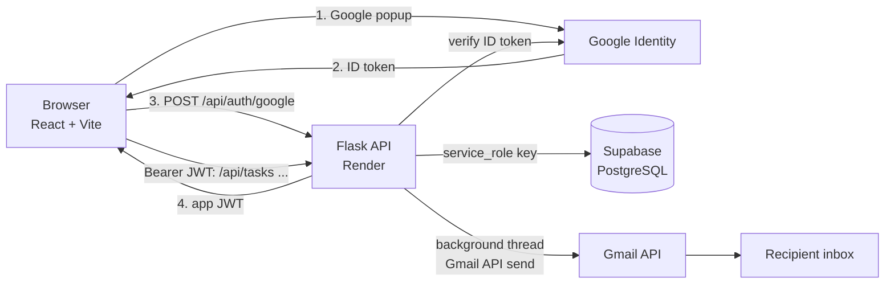

# Tasklane

A task management web app for teams. Sign in with Google, create tasks, assign them to teammates, and get Gmail notifications when a task is created and when it is completed.

Built for the Hairdrama Tech internship assignment.

**Live app:** `https://YOUR-APP.vercel.app` &nbsp;|&nbsp; **API:** `https://YOUR-API.onrender.com/api/health`

| Layer | Choice |
|---|---|
| Frontend | React 18 + Vite (Vercel) |
| Backend | Flask 3 + Gunicorn (Render) |
| Database | Supabase (PostgreSQL) |
| Login | Google OAuth 2.0 / OpenID Connect (Google Identity Services) |
| Email | Gmail API (OAuth 2.0 refresh token) |

## Features

**Required**
- Google sign-in; accounts are created automatically on first login
- Create tasks with title, description, priority and due date
- Assign tasks to any other registered user (or yourself)
- Email notification on task creation and on task completion, sent through Gmail

**Extras added from a business point of view**
- Kanban board (To do / In progress / Done) with one-click status changes
- Filters: assigned to me, created by me, all my tasks, plus title search and priority filter
- Summary strip: open for you, in progress, overdue, completed
- Overdue highlighting
- Comments on every task
- Edit and delete (creator only); assignees can update status
- Reassignment email when a task is handed to someone new
- Deep links in emails (`/?task=<id>` opens that task)
- Email audit log table (`email_logs`: sent, failed or skipped, with the error)
- Privacy: a task is visible only to its creator and its assignee

## Architecture



```
tasklane/
├── backend/                Flask API
│   ├── app/
│   │   ├── __init__.py       app factory, CORS, JSON error handlers
│   │   ├── config.py         environment configuration
│   │   ├── db.py             Supabase client (service_role)
│   │   ├── auth.py           JWT issue + @login_required
│   │   ├── routes_auth.py    /auth/google, /auth/me, /users
│   │   ├── routes_tasks.py   tasks CRUD, comments, stats, permissions
│   │   └── emailer.py        Gmail API sender + email templates + logging
│   ├── scripts/get_gmail_refresh_token.py
│   ├── tests/                pytest (unit + fake-Supabase flow tests)
│   ├── wsgi.py, Procfile, requirements.txt
├── frontend/               React app
│   └── src/
│       ├── api.js, auth.jsx  API client, auth context
│       ├── pages/            Login, Board
│       └── components/       TaskCard, TaskForm, TaskDrawer, Avatar
├── migrations/             SQL, run in order
├── docs/LOOM_SCRIPT.md     walkthrough script for the video
├── render.yaml             Render blueprint
└── .env.example
```

### Request flow

1. **Login.** The browser gets a Google ID token from Google Identity Services and posts it to `POST /api/auth/google`. Flask verifies the token's signature, audience and expiry with `google-auth`, upserts the user in Supabase, and returns its own signed JWT (7 days). The frontend sends it as `Authorization: Bearer ...`.
2. **Create task.** `POST /api/tasks` validates input, checks the assignee exists, inserts the row and returns the task with creator and assignee embedded. Notification emails are queued on a background thread so the response is not delayed.
3. **Complete task.** `PATCH /api/tasks/:id {"status":"completed"}` sets `completed_at` and emails both the creator and the assignee. Completing an already-completed task does not send again.
4. **Authorization.** Every route is behind `@login_required`. Only the creator or assignee can read a task; only the creator can edit details or delete; the assignee can change status.

### Design decisions

- **Gmail API instead of SMTP.** Render and Railway free tiers block outbound SMTP ports; the Gmail API uses HTTPS and always works.
- **Backend-only database access.** The Flask API uses the Supabase `service_role` key and RLS is enabled with no policies, so the public anon key can read nothing. The key never reaches the browser.
- **Own JWT after Google login.** Keeps the API stateless and avoids sending Google tokens on every request.
- **Notifications never block or break a request.** Failures are caught and recorded in `email_logs`.

## Database

Run the files in `migrations/` in order, in the Supabase SQL Editor:

| File | Creates |
|---|---|
| `001_init_users_tasks.sql` | `users`, `tasks`, indexes, `updated_at` trigger |
| `002_comments_and_email_logs.sql` | `task_comments`, `email_logs` |
| `003_enable_rls.sql` | Row Level Security on all tables |

## API

All routes are under `/api` and need `Authorization: Bearer <token>` except `health` and `auth/google`.

| Method | Path | Notes |
|---|---|---|
| GET | `/health` | liveness |
| POST | `/auth/google` | `{credential}` returns `{token, user}` |
| GET | `/auth/me` | current user |
| GET | `/users` | users who have signed in (assignee picker) |
| GET | `/tasks` | `scope=assigned|created|mine`, `q`, `priority`, `status` |
| POST | `/tasks` | `{title, description?, assigned_to?, priority?, due_date?}` |
| GET | `/tasks/:id` | task plus comments |
| PATCH | `/tasks/:id` | creator: any field; assignee: `status` only |
| DELETE | `/tasks/:id` | creator only |
| POST | `/tasks/:id/comments` | `{body}` |
| GET | `/stats` | counts for the summary strip |

## Local setup

Prerequisites: Python 3.11+, Node 18+, a Supabase project, a Google Cloud project.

### 1. Supabase
1. Create a project. Open **SQL Editor** and run the three files in `migrations/`.
2. **Project Settings → API**: copy the Project URL and the `service_role` key.

### 2. Google sign-in
1. [Google Cloud Console](https://console.cloud.google.com) → create a project → **APIs & Services → OAuth consent screen** (External). Add yourself and your testers under *Test users*.
2. **Credentials → Create credentials → OAuth client ID → Web application**.
3. Under **Authorized JavaScript origins** add `http://localhost:5173` and, later, your Vercel URL. No redirect URI is needed.
4. Copy the client ID: it is `GOOGLE_CLIENT_ID` (backend) and `VITE_GOOGLE_CLIENT_ID` (frontend).

### 3. Gmail sending (one time)
1. In the same project enable the **Gmail API**.
2. On the consent screen add the scope `https://www.googleapis.com/auth/gmail.send`.
3. Create another OAuth client of type **Desktop app**.
4. Run the helper and sign in with the Gmail account that should send the emails:
   ```bash
   cd backend
   pip install -r requirements-dev.txt
   python scripts/get_gmail_refresh_token.py
   ```
5. Put the printed values in `backend/.env` along with `GMAIL_SENDER=<that gmail address>`.

> **Important:** while the consent screen is in *Testing* mode, refresh tokens expire after 7 days. Set the publishing status to **In production** (Google shows an "unverified app" warning for the sender account, which is fine for this use) so emails keep working.

### 4. Run
```bash
# backend
cd backend
python -m venv .venv && source .venv/bin/activate     # Windows: .venv\Scripts\activate
pip install -r requirements.txt
cp .env.example .env                                   # fill in the values
python wsgi.py                                         # http://localhost:5000

# frontend (new terminal)
cd frontend
npm install
cp .env.example .env                                   # fill in the values
npm run dev                                            # http://localhost:5173
```
To test assignment you need two accounts: sign in once with each Google account (a user appears in the assignee list after their first login).

### Tests
```bash
cd backend && pip install -r requirements-dev.txt && pytest
```
The tests cover validation, auth guards, permissions, the create → assign → complete flow, email triggers and email escaping, using an in-memory fake of the Supabase client.

## Deployment

**Backend on Render**
1. New → Blueprint → select this repo (uses `render.yaml`), or create a Web Service with root directory `backend`, build `pip install -r requirements.txt`, start `gunicorn wsgi:app`.
2. Set the environment variables from `backend/.env.example`. `FRONTEND_URL` and `CORS_ORIGINS` must be your exact Vercel URL (no trailing slash).
3. Check `https://YOUR-API.onrender.com/api/health`. The free plan sleeps when idle, so the first request after a pause can take about a minute.

**Frontend on Vercel**
1. Import the repo, set **Root Directory** to `frontend` (framework: Vite).
2. Environment variables: `VITE_API_URL=https://YOUR-API.onrender.com` and `VITE_GOOGLE_CLIENT_ID=...`.
3. Deploy, then add the Vercel URL to the Google client's **Authorized JavaScript origins**.

**Production checklist**
- [ ] Sign in with Google works on the live URL
- [ ] Creating a task assigned to a second account sends an email to that account and a confirmation to the creator
- [ ] Marking the task complete emails both people
- [ ] `email_logs` shows `sent` rows in Supabase

## Troubleshooting

| Symptom | Fix |
|---|---|
| Google popup says `origin_mismatch` | Add the exact site URL to Authorized JavaScript origins |
| `Invalid Google token` on login | `GOOGLE_CLIENT_ID` in the backend differs from the one in the frontend |
| Browser CORS error | `CORS_ORIGINS` must include the exact frontend origin |
| No emails; `email_logs.status = failed` | Read the `error` column. `invalid_grant` means the refresh token expired or was revoked: publish the consent screen to production and generate a new token |
| `email_logs.status = skipped` | Gmail variables are missing on the server |
| Assignee not in the dropdown | They have not signed in yet |
